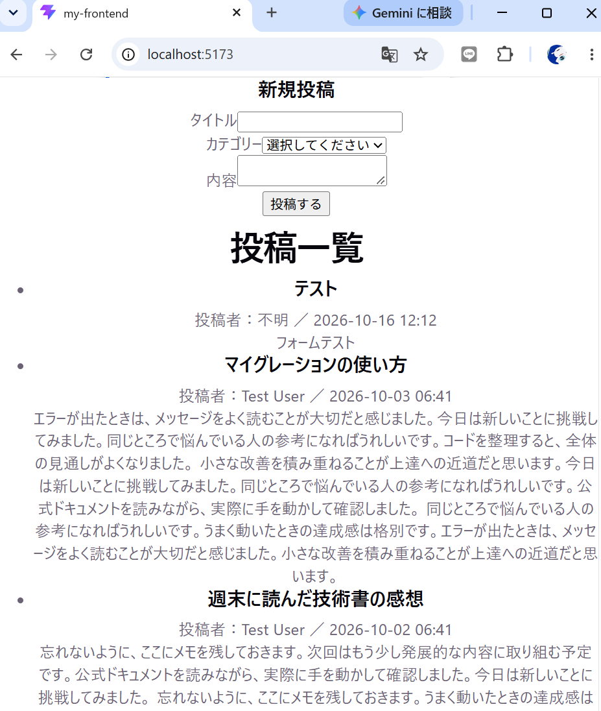

# Laravel Docker App

Docker Compose上のLaravel(MVC)で作成した学習用アプリです。
**ログイン機能付き掲示板**のほか、**ブログシステム**と**イベント予約システム**を含みます。

## 使用技術

- PHP 8.2 / Laravel 12
- Laravel Breeze(ユーザー登録・ログイン)
- MySQL 8.0
- Nginx / phpMyAdmin
- Docker Compose
- Tailwind CSS / Vite(Breeze の画面・掲示板)
- Bootstrap 5(CDN、ブログ・イベント予約の画面)

## 機能一覧

| 機能 | URL | ログイン |
| --- | --- | --- |
| ユーザー登録 | `/register` | 不要 |
| ログイン / ログアウト | `/login` / ナビゲーションのメニュー | 不要 |
| パスワードリセット | `/forgot-password` | 不要 |
| ダッシュボード | `/dashboard` | 必要 |
| プロフィール編集・退会 | `/profile` | 必要 |
| 掲示板の閲覧 | `/comments` | 不要 |
| 掲示板への投稿 | `/comments` の投稿フォーム | 必要 |
| 掲示板の投稿削除 | 各投稿の「削除」 | 必要(投稿者本人のみ) |
| ブログの閲覧・投稿 | `/posts` | 必要 |
| ブログの編集・削除 | 投稿詳細の「編集」「削除」 | 必要(投稿者本人のみ) |
| イベント・予約 | `/events`、`/reservations` | 不要 |

バリデーションエラーや Breeze の画面の文言は日本語で表示されます(`APP_LOCALE=ja`、翻訳は `src/lang/ja` と `src/lang/ja.json`)。

## 機能説明

### 認証(Laravel Breeze)

- ユーザー登録・ログイン・ログアウト・パスワードリセット・プロフィール編集・退会。
- ログインは同じメールアドレス + IP からの失敗が5回でロックされます。
- ログイン・ログアウト時にセッション ID を再生成します。
- 未ログインでログイン必須の画面を開くと `/login` にリダイレクトされます。

### 掲示板

| 機能 | URL | 説明 |
| --- | --- | --- |
| 投稿一覧 | `GET /comments` | 新しい順に20件ずつ表示。投稿者名と投稿日時を表示。誰でも閲覧可 |
| 投稿 | `POST /comments` | ログインユーザーのみ。未ログイン時はフォームの代わりにログイン・登録への案内を表示 |
| 削除 | `DELETE /comments/{id}` | 投稿者本人のみ。削除ボタンも本人にだけ表示。他人が削除しようとすると 403 |

- バリデーション: 本文は必須・1000文字以内。
- 投稿者(`user_id`)はリクエストの値ではなく、ログイン中のユーザーから設定します。
- 連投制限: 1ユーザーにつき1分間に10件まで(超えると 429)。
- 削除の権限は `app/Policies/CommentPolicy.php` で判定します。
- セキュリティテストの結果は [docs/security-report.md](docs/security-report.md) を参照してください。

### ブログシステム

| 機能 | URL | 説明 |
| --- | --- | --- |
| 投稿一覧 | `/posts` | 新しい順に10件ずつ表示(ページネーション付き) |
| 投稿詳細 | `/posts/{id}` | タイトル・カテゴリー・投稿者・本文・投稿日を表示 |
| 投稿作成 | `/posts/create` | タイトル・内容・カテゴリーを入力して投稿 |
| 投稿編集 | `/posts/{id}/edit` | 投稿内容を更新(投稿者本人のみ) |
| 投稿削除 | 詳細画面の「削除」 | 確認ダイアログの後に削除(投稿者本人のみ) |

- すべての画面でログインが必要です。
- 投稿者(`user_id`)はログイン中のユーザーから設定します。編集・削除の権限は `app/Policies/PostPolicy.php` で判定し、ボタンも投稿者本人にだけ表示します。他人が操作しようとすると 403 になります。
- バリデーション: タイトルは必須・255文字以内、内容は必須、カテゴリーは必須かつ存在するもの。作成・更新で共通の `PostRequest` を使います。エラーは各入力欄の下に日本語で表示され、入力値は保持されます。
- Bladeレイアウト継承: ブログとイベント予約の画面は `layouts/blog.blade.php`(Bootstrap)を継承し、作成・編集フォームは `posts/_form.blade.php` を共通化しています。認証と掲示板の画面は Breeze の `layouts/app.blade.php`(Tailwind CSS)を使います。

#### 設計(Repository / Service パターン)

コントローラーに処理を詰め込まないよう、役割ごとにクラスを分けています。

```
リクエスト → PostRequest(バリデーション)
          → PostController(受け取って渡すだけ)
              ├─ PostPolicy(編集・削除の権限チェック)
              ├─ PostService(処理の流れ)
              │    └─ PostRepository(DB 操作)
              └─ PostRepository / CategoryRepository(表示用データの取得)
```

| クラス | 役割 |
| --- | --- |
| `app/Http/Controllers/PostController.php` | リクエストを受け取り、Service / Repository を呼んで画面を返すだけにしています |
| `app/Services/PostService.php` | 投稿の作成・更新・削除。トランザクション(`DB::transaction`)とログ記録もここで行います |
| `app/Repositories/PostRepository.php` | 投稿の取得・保存などの Eloquent 操作をまとめています |
| `app/Repositories/CategoryRepository.php` | 投稿フォームのカテゴリー一覧を取得します |
| `app/Policies/PostPolicy.php` | 「投稿者本人だけが編集・削除できる」というルールを定義します |

- Service と Repository はコンストラクタインジェクションで受け取ります(Laravel のサービスコンテナが自動で生成します)。
- 認可はコントローラーで `$this->authorize('update', $post)` のように呼び、権限がなければ自動で 403 を返します。`$this->authorize()` を使えるように、基底の `Controller` に `AuthorizesRequests` トレイトを追加しています。

### イベント予約システム

| 機能 | URL | 説明 |
| --- | --- | --- |
| イベント一覧 | `/events` | 開催日時順に表示。残席数も確認できます |
| イベント詳細 | `/events/{id}` | 場所・開催日時・残席・内容を表示。満席の場合は予約ボタンが無効になります |
| イベント作成 | `/events/create` | イベント名・場所・開催日時・定員・内容を入力して作成 |
| 予約作成 | `/events/{id}/reservations/create` | 名前・メールアドレス・人数・予約日時を入力して予約 |
| 予約一覧 | `/reservations` | 予約の状態(予約中 / キャンセル済み)を表示 |
| 予約のキャンセル | 予約一覧の「キャンセル」 | 確認ダイアログの後にキャンセル |

- バリデーション(予約): 名前は必須、メールアドレスは形式チェック、人数は1人以上かつ残席以下、予約日時は現在より後。
- バリデーション(イベント): すべて必須。開催日時は現在より後、定員は1以上。
- 残席の計算: `定員 - 有効な予約の合計人数`。キャンセル済みの予約は含めません。
- キャンセル: 予約を削除せず、`cancelled_at` に日時を記録します。

## テーブル定義

Breeze 標準の `users`、`sessions`、`password_reset_tokens` などは省略しています。

### comments(掲示板の投稿)

| カラム | 型 | NULL | 説明 |
| --- | --- | --- | --- |
| id | bigint unsigned | NO | 主キー |
| user_id | bigint unsigned | NO | 外部キー(users.id)。ユーザー削除時は投稿も削除 |
| body | text | NO | 本文 |
| created_at | timestamp | YES | 作成日時 |
| updated_at | timestamp | YES | 更新日時 |

### categories(カテゴリー)

| カラム | 型 | NULL | 説明 |
| --- | --- | --- | --- |
| id | bigint unsigned | NO | 主キー |
| name | varchar(255) | NO | カテゴリー名 |
| created_at | timestamp | YES | 作成日時 |
| updated_at | timestamp | YES | 更新日時 |

### posts(投稿)

| カラム | 型 | NULL | 説明 |
| --- | --- | --- | --- |
| id | bigint unsigned | NO | 主キー |
| user_id | bigint unsigned | YES | 外部キー(users.id)。投稿者。ユーザー削除時は投稿も削除。カラム追加前の投稿は NULL(誰も編集・削除できない) |
| category_id | bigint unsigned | NO | 外部キー(categories.id)。カテゴリー削除時は投稿も削除 |
| title | varchar(255) | NO | タイトル |
| content | text | NO | 内容 |
| created_at | timestamp | YES | 作成日時 |
| updated_at | timestamp | YES | 更新日時 |

### events(イベント)

| カラム | 型 | NULL | 説明 |
| --- | --- | --- | --- |
| id | bigint unsigned | NO | 主キー |
| title | varchar(255) | NO | イベント名 |
| description | text | NO | 内容 |
| location | varchar(255) | NO | 場所 |
| starts_at | datetime | NO | 開催日時 |
| capacity | int unsigned | NO | 定員 |
| created_at | timestamp | YES | 作成日時 |
| updated_at | timestamp | YES | 更新日時 |

### reservations(予約)

| カラム | 型 | NULL | 説明 |
| --- | --- | --- | --- |
| id | bigint unsigned | NO | 主キー |
| event_id | bigint unsigned | NO | 外部キー(events.id)。イベント削除時は予約も削除 |
| name | varchar(255) | NO | 予約者名 |
| email | varchar(255) | NO | メールアドレス |
| guests | int unsigned | NO | 人数 |
| reserved_at | datetime | NO | 予約日時 |
| cancelled_at | timestamp | YES | キャンセル日時(NULLなら有効な予約) |
| created_at | timestamp | YES | 作成日時 |
| updated_at | timestamp | YES | 更新日時 |

### リレーション

```
users      1 ── * comments
users      1 ── * posts
categories 1 ── * posts
events     1 ── * reservations
```

## スクリーンショット

### ブログシステム

| 投稿一覧 | 投稿詳細 |
| --- | --- |
|  |  |

| 投稿作成 | 投稿編集 |
| --- | --- |
|  |  |

| 投稿作成(バリデーションエラー) |
| --- |
|  |

### イベント予約システム

| イベント一覧 | イベント詳細 |
| --- | --- |
|  |  |

| 予約作成 | 予約一覧(キャンセル済みを含む) |
| --- | --- |
|  |  |

## ディレクトリ構成(主要部分)

```
src/
├── app/
│   ├── Http/
│   │   ├── Controllers/   CommentController, PostController, EventController, ReservationController,
│   │   │                  ProfileController, Auth/(Breeze)
│   │   └── Requests/      PostRequest, StoreEventRequest, StoreReservationRequest
│   ├── Models/            User, Comment, Post, Category, Event, Reservation
│   ├── Policies/          CommentPolicy, PostPolicy
│   ├── Repositories/      PostRepository, CategoryRepository
│   └── Services/          PostService
├── database/
│   ├── migrations/        users, comments, categories, posts, events, reservations
│   ├── factories/
│   └── seeders/           DatabaseSeeder, CategorySeeder, EventSeeder
├── lang/                  ja/(バリデーション等の日本語訳), ja.json(Breeze 画面の日本語訳)
├── resources/views/
│   ├── layouts/           app(Breeze), guest, navigation, blog(ブログ・イベント予約用)
│   ├── auth/              ログイン・登録など(Breeze)
│   ├── comments/          掲示板
│   ├── posts/
│   ├── events/
│   └── reservations/
├── routes/
│   ├── web.php
│   └── auth.php           認証関連のルート(Breeze)
└── tests/Feature/         CommentTest, PostTest など
```

## 環境構築(clone した人向け)

Laravel 本体はこのリポジトリの `src/` に含まれているため、`composer create-project` は不要です。
事前に以下をインストールしてください。

- Docker Desktop(Docker Compose)
- Node.js 20.19 以上(画面の CSS / JS のビルドに使用。PHP コンテナには Node.js が入っていないため、ホスト側で実行します)

### 1. リポジトリの取得

```bash
git clone https://github.com/remi-code-dev/techmeets-month2.git
cd techmeets-month2
```

### 2. Docker 用の環境変数ファイルを作成

```bash
cp .env.example .env
```

`docker-compose.yml` が読み込む設定です。ポート番号やDBパスワードは必要に応じて `.env` で変更できます。

| 変数 | 既定値 | 説明 |
| --- | --- | --- |
| `NGINX_PORT` | 80 | Laravel にアクセスするポート |
| `DB_PORT` | 3306 | MySQL に公開するポート |
| `PMA_PORT` | 8080 | phpMyAdmin にアクセスするポート |
| `DB_PASSWORD` | secret | MySQL の root パスワード(`docker-compose.yml` の3か所で共通利用) |

### 3. コンテナの起動

```bash
docker compose up -d --build
```

### 4. Laravel のセットアップ

```bash
# Laravel 用の .env を作成(DB設定は MySQL 用になっています)
cp src/.env.example src/.env

# 依存パッケージのインストール
docker compose exec app composer install

# アプリケーションキーの生成
docker compose exec app php artisan key:generate

# 権限の設定(Laravel がログ等を書き込めるようにする)
docker compose exec app chown -R www-data:www-data storage bootstrap/cache
docker compose exec app chmod -R 775 storage bootstrap/cache

# マイグレーションと初期データの投入
docker compose exec app php artisan migrate --seed
```

`.env` の `DB_PASSWORD` を変更した場合は、`src/.env` の `DB_PASSWORD` も同じ値にしてください。

すでに環境を作ってある場合は、`git pull` の後に以下を実行してください。

- `docker compose exec app php artisan migrate`(`posts.user_id` の追加)
- `src/.env` の `APP_LOCALE` を `ja` に変更(エラーメッセージの日本語化)

`user_id` を追加する前に作った投稿は投稿者が NULL になり、誰も編集・削除できません。不要であれば `docker compose exec app php artisan migrate:fresh --seed` で作り直してください(**DB のデータはすべて消えます**)。

初期データとして、以下が登録されます。

- テストユーザー1件(メール: `test@example.com`、パスワード: `password`)
- カテゴリー4件(お知らせ・技術・日記・レビュー)
- イベント3件(グッズ先行販売)

### 5. フロントエンドのビルド

`public/build` は Git の管理対象外なので、clone 後に一度ビルドが必要です。ビルドしないと画面表示時に `Vite manifest not found` エラーになります。

```bash
cd src
npm install
npm run build
cd ..
```

開発中に CSS / Blade を変更しながら確認する場合は、`npm run build` の代わりに `npm run dev` を起動したままにします。

### 6. 動作確認

- Laravel: http://localhost(`NGINX_PORT` を変えた場合は `http://localhost:{NGINX_PORT}`)
  - 掲示板: http://localhost/comments
  - ログイン: http://localhost/login(上記のテストユーザー、または `/register` で登録したユーザー)
- phpMyAdmin: http://localhost:8080(サーバ: `db`、ユーザー: `root`)

パスワードリセットのメールは送信されず、`MAIL_MAILER=log` により `src/storage/logs/laravel.log` に出力されます。

### 7. テストの実行

```bash
docker compose exec app php artisan test
```

テストは SQLite のインメモリ DB で実行されるため、MySQL のデータには影響しません。

### 8.week9/Repository/Service層の実装
Before
- ControllerにDB処理やビジネスロジックが書かれていた
After
- DB処理をPostRepositoryへ移動
- ビジネスロジックをPostServiceへ移動
- PostPolicyを作成して認可を管理
- Controllerをシンプルな構成に変更

### 9.week10/React フロントエンドのコンポーネント設計
#### Reactの動かし方
- 初回は、上の「環境構築」1〜5 を先に済ませておく
1. Laravel 側（Docker）を起動しておく
```bash
 docker compose up -d
```
2. React の依存パッケージをインストールする（初回のみ）
```bash
  cd my-frontend
  npm install
```
3. 開発サーバーを起動する
```bash
  npm run dev
```
4. ブラウザで http://localhost:5173 を開く


- Reactが呼んでいるAPIのURL(http://localhost/api/posts)
- CORSの設定(config/cors.php で localhost:5173を許可している)

#### コンポーネント分割の理由
　コンポーネント分割は前提として再利用性やコードの複雑さ解消のために行う。今回は、フォーム（PostForm）・一覧（PostList）・投稿1件の表示（PostItem）に分けた。フォームはデータ保存の役割、一覧はデータを表示する役割で、それぞれ役割が異なるため、分けた。PostItemは1件ごとの処理に分けられるため分割した。

### 10.week11/デプロイ手順とセキュリティグループの設計説明
- デプロイ手順
1. 概要
Laravelで作成したアプリを、AWSのEC2・RDSを利用してデプロイする。
+ EC2:AWSが提供する仮想サーバー
+ RDS:AWSが管理するデータベースサービス
2. デプロイ手順
 - GitBashからSSHを利用してEC2に接続する。

 ```bash
 ssh -i 秘密鍵ファイル.pem ubuntu@EC2のElasticIP
 ```

 - Dockerのインストール
 EC2上でDockerとDocker Composeをインストールし、利用できることを確認する
 ```bash
 docker --version
 docker compose version
 ```

 - GitHubからアプリを取得
 GitHubのリポジトリをEC2にクローンする。
 ```bash
 git clone GitHubリポジトリのURL
 cd リポジトリ名
 ```

 - 環境変数の設定
 Docker用とLaravel用の環境設定ファイルを作成する。
 ```bash
 cp .env.example .env
 cp src/.env.example src/.env
 ```
 src/.env に以下の設定を行う。
 + APP_URL：EC2のElastic IPを使用したURL
 + DB_CONNECTION：mysql
 + DB_HOST：RDSのエンドポイント
 + DB_PORT=3306
 + DB_DATABASE：laravel
 + DB_USERNAME：RDSのユーザー名
 + DB_PASSWORD：RDSのパスワード

 - Docker Composeの設定変更
 本番環境ではデータベースにRDSを利用するため、docker-compose.ymlからdbサービスとphpmyadminサービスを削除する。
 また、app サービスの depends_on から db の指定を削除する。

 - コンテナの起動とLaravelの準備
 ```bash
 docker compose up -d
 docker compose exec app composer install
 docker run --rm -v "$(pwd)/src:/app" -w /app node:lts sh -c "npm ci && npm run build"
 docker compose exec app php artisan key:generate
 docker compose exec app php artisan migrate
 ```

 - 動作確認
 ```bash
 docker compose ps
 ```
 コンテナが起動していることを確認し、ブラウザから以下のURLにアクセスする。
 http://EC2のElastic_IP
 
- EC2用のセキュリティグループ設定理由
SSHは自分のIPアドレスのみに開けている。SSHとは、パソコンからEC2にログインし、コマンドを実行するための仕組み。自分のIPアドレスに限定すれば、許可したIPアドレスからの接続しか受け入れない。不正アクセスのリスクを減らすために自分のIPアドレスのみにしている。HTTPは全部のIPアドレスを許可している。HTTPはWebサイトを表示するためのポートであるため、だれでもアクセスできるようにするから、全許可している。HTTPSはHTTPのより安全にWebサイトを表示するためのポートである。公開範囲はHTTPと同じ理由。

### 11.week12/外部API(Stripe)を利用した機能のEC2へのデプロイ手順
1. 概要
week11でEC2・RDSにデプロイしたアプリに、Stripeを使った投げ銭(応援)機能を追加し、EC2上でも使えるようにする。
+ EC2 → Stripe：決済画面(Checkout Session)を作成する
+ Stripe → EC2：決済が完了したことをWebhookで通知する

2. デプロイ手順
 - EC2に接続し、EC2上に変更が残っていないか確認してから、最新のコードを取得する。
 ```bash
 ssh -i 秘密鍵ファイル.pem ubuntu@EC2のElasticIP
 cd リポジトリ名
 git status
 git pull
 git log --oneline -3
 ```
 git log で最新のコミットが取り込まれていることを確認する。

 - Docker Composeの設定変更
 week11と同じく、docker-compose.ymlからdbサービスとphpmyadminサービス、appサービスの depends_on の db を削除する。
 また、appサービスの environment(DB_HOST=db など)を削除し、src/.env のRDSの設定が使われるようにする。

 - Stripeのライブラリをインストールする。
 ```bash
 docker compose up -d
 docker compose restart nginx
 docker compose exec app composer install
 ```

 - src/.env にStripeのキーを設定する。
 .env はGitで管理していないため、git pull では反映されない。EC2上で直接書き足す。
 + STRIPE_KEY：公開可能キー(pk_test_から始まる)
 + STRIPE_SECRET：シークレットキー(sk_test_から始まる)
 + STRIPE_WEBHOOK_SECRET：Webhookの署名シークレット(whsec_から始まる。下のWebhookの登録で取得する)

 - マイグレーションを実行し、応援履歴のテーブル(supports)を作成する。
 ```bash
 docker compose exec app php artisan migrate
 ```

 - StripeダッシュボードでWebhookの送信先を登録する。
 ローカルではStripe CLIの stripe listen がWebhookを中継していたが、EC2はインターネットから直接アクセスできるため、StripeからEC2に直接送ってもらう。
 + エンドポイントURL：http://EC2のElasticIP/api/webhook/stripe
 + 受け取るイベント：checkout.session.completed
 + 登録後に表示される署名シークレットを src/.env の STRIPE_WEBHOOK_SECRET に設定する
 + 署名シークレットは送信先ごとに異なるため、stripe listen で表示された whsec_ とは別の値になる

 - 設定を反映する。
 ```bash
 docker compose exec app php artisan config:clear
 ```

 - 動作確認
 + ブラウザで記事の応援ボタンを押し、テストカード(4242 4242 4242 4242)で支払う
 + 完了画面が表示されることを確認する
 + Webhookが届いたことを確認する(Stripeダッシュボードの配信結果、またはNginxのログで200になっていること)
 ```bash
 docker compose logs nginx | grep webhook
 ```

3. つまずいた点と対処
 - git pull しても最新のコードが取り込まれなかった
 + 原因：week11でEC2上の docker-compose.yml を直接書き換えていた。week12でGitHub側の docker-compose.yml も変更したため、pullするとEC2での変更が上書きされて消えてしまう状態になり、Gitがpullを中止(Aborting)していた。pullの結果を確認せずに次の手順に進んだため、古いコードのまま作業していた。
 + 対処：docker-compose.yml をバックアップしてから元に戻し、pullした後にEC2用の変更をやり直した。
 ```bash
 cp docker-compose.yml ~/docker-compose.yml.ec2-backup
 git restore docker-compose.yml
 git pull
 ```

 - DBに接続できなかった(Host: db)
 + 原因：docker-compose.yml の app サービスの environment に DB_HOST=db が書かれており、src/.env のRDSの設定より優先されていた。week11ではこれも削除していたが、手順に書いていなかったため、やり直すときに抜けていた。
 + 対処：environment を削除し、src/.env の設定を使うようにした。

 - 502 Bad Gateway が表示された
 + 原因：docker-compose.yml を変更したことで app コンテナが作り直され、IPアドレスが変わった。Nginxは起動時に調べた古いIPアドレスに接続しようとしていた。
 + 対処：Nginxを再起動して、新しいIPアドレスを読み込ませた。
 ```bash
 docker compose restart nginx
 ```

4. 再発防止
 - git pull の後は git log で最新のコミットが取り込まれたことを確認してから、次の手順に進む。
 - 今後の改善として、EC2用の設定を docker-compose.prod.yml として別に作成してリポジトリに含めれば、EC2で docker-compose.yml を書き換える必要がなくなり、pullがぶつからなくなる。

5. 補足(レビュー後の改善)
 - Webhookで2つのイベントを処理するように変更した。
 + checkout.session.completed：応援履歴を保存し、支払いページのID(cs_から始まる)をログに記録する
 + payment_intent.succeeded：決済ID(pi_から始まる)をログに記録する(練習課題2の内容)
 + 1回の支払いで、Stripeから2つの通知が別々に届く。応援履歴を保存するのは checkout.session.completed のときだけなので、履歴が2回保存されることはない

 - ローカルで確認するときは、stripe listen で転送するイベントを指定する(新しいStripe CLIでは --events などの指定が必要)。
 ```bash
 stripe listen --events checkout.session.completed,payment_intent.succeeded --forward-to localhost/api/webhook/stripe
 ```

 - EC2用の設定を docker-compose.prod.yml としてリポジトリに追加した。
 + EC2で docker-compose.yml を直接書き換えなくてよくなり、git pull がぶつからなくなる
 + db・phpmyadmin：RDSを使うため含めない
 + mailpit：EC2では MAIL_MAILER=log でメールを laravel.log に書き出しており、使っていないため含めない
 + nginx：EC2上のNginx(HTTPS・certbot)から転送を受けるため、127.0.0.1:8000 で待ち受ける

 - EC2で docker-compose.prod.yml を使うように切り替える。
 ```bash
 cp docker-compose.yml ~/docker-compose.yml.ec2-backup
 git restore docker-compose.yml
 git pull
 git log --oneline -3
 echo "COMPOSE_FILE=docker-compose.prod.yml" >> .env
 docker compose up -d --remove-orphans
 docker compose restart nginx
 docker compose ps
 ```
 + .env(プロジェクト直下)に COMPOSE_FILE を書くと、-f を付けなくても docker compose が docker-compose.prod.yml を使う
 + --remove-orphans で、prod用のファイルに書いていないコンテナ(mailpit)を削除する
 + 以降の手順にある「docker-compose.ymlからdbサービスなどを削除する」作業は不要になる

 - HTTPS化に合わせて設定を変更した。
 + src/.env：APP_URL=https://ドメイン に変更し、php artisan config:clear を実行する
 + Stripeダッシュボードの送信先を編集し、エンドポイントURLを https://ドメイン/api/webhook/stripe に変更する
 + 受け取るイベントに payment_intent.succeeded を追加する
 + 送信先を「編集」した場合、署名シークレット(whsec_)は変わらないので STRIPE_WEBHOOK_SECRET の変更は不要

 - つまずいた点と対処
 + Stripeの配信結果が 301 になり、Webhookが届かなかった
 + 原因：エンドポイントURLが http:// のままだった。EC2のNginxが https:// へリダイレクト(301)を返すが、Stripeはリダイレクトを追いかけないため、アプリまで届かなかった
 + 対処：エンドポイントURLを https:// に直した
 + 確認方法：Stripeダッシュボードの送信先のイベント配信で、ステータスコードを見る

### 12.week13/独自ドメインとHTTPSの設定
1. 概要
week11でEC2にデプロイしたアプリに独自ドメイン(rabblog.com)を設定し、Let's Encrypt の証明書でHTTPS化した。
+ 公開URL：https://rabblog.com

2. コマンドでの動作確認
 - dig rabblog.com +short
 ```bash
 $ dig rabblog.com +short
 13.158.15.78
 ```
 + EC2のElastic IP(13.158.15.78)が返ってきた。
 + ドメイン名がEC2のIPアドレスに結びついており、Route 53 のAレコードが反映されていることを意味する。

 - curl -I https://rabblog.com
 ```bash
 $ curl -I https://rabblog.com
 HTTP/1.1 200 OK
 Server: nginx/1.28.3 (Ubuntu)
 Content-Type: text/html; charset=utf-8
 Set-Cookie: XSRF-TOKEN=...; secure; samesite=lax
 Set-Cookie: laravel-session=...; secure; httponly; samesite=lax
 ```
 + HTTP/1.1 200 OK：HTTPSでアクセスして、ページを正常に返せた。
 + Server：応答したのはEC2上のNginx(HTTPSを受けて、Dockerのコンテナに転送している)。
 + Content-Type：返ってきた中身はHTMLのページ。
 + Set-Cookie の secure：HTTPSのときだけ送られるCookie。LaravelがHTTPSで通信していると正しく判断できている。EC2のNginxからDockerのnginxへはhttpで転送しているが、EC2のNginxが付けた X-Forwarded-Proto(元はhttpsだったというメモ)を、trustProxies の設定でLaravelが信じているため。
 + APP_URL は secure とは関係なく、artisan コマンドやキューでのメール送信など、ブラウザからのアクセスがない場面でURLを作るときに使われる。

 - sudo certbot certificates
 ```bash
 $ sudo certbot certificates
   Certificate Name: rabblog.com
     Domains: rabblog.com www.rabblog.com
     Expiry Date: 2027-02-01 11:55:21+00:00 (VALID: 89 days)
 ```
 + Domains：証明書は rabblog.com と www.rabblog.com の両方で使える。
 + Expiry Date：有効期限は2027年2月1日で、残り89日。Let's Encrypt の証明書は90日で期限が切れる。

 - 自動更新の設定の確認
 ```bash
 $ systemctl list-timers | grep certbot
 Wed 2026-11-04 10:42:08 UTC  6h  Tue 2026-11-03 12:51:52 UTC  -  certbot.timer  certbot.service
 ```
 + certbot.timer が登録されており、1日2回 certbot が自動で実行される。期限が近づく(残り30日ほど)と、証明書が自動で更新される。
 + sudo certbot renew --dry-run(更新できるかの練習)は、EC2から Let's Encrypt の練習用サーバー(staging)につながらず失敗した(Connection reset by peer)。本番のサーバーには curl でつながることを確認した。時間をおいて再確認する。

3. wwwなし・ありの統一
 - www.rabblog.com にアクセスしても、https://rabblog.com(wwwなし)に移動(301リダイレクト)するように、EC2上のNginxの設定(/etc/nginx/sites-available/myapp.conf)を変更した。
 - 変更前の問題
 + HTTPSの設定で rabblog.com と www.rabblog.com の両方を受け付けていたため、https://www.rabblog.com でも www 付きのままページが表示されていた。
 + HTTPの設定は return 301 https://$host$request_uri; になっていた。$host にはアクセスした人が入力したドメイン名がそのまま入るため、http://www.rabblog.com は https://www.rabblog.com に移動し、www が残っていた。
 - 変更後の設定(server のかたまりを3つに分けた)
 ```nginx
 # ① HTTPS（wwwなし）：Dockerのnginxコンテナに転送する
 server {
     listen 443 ssl; # managed by Certbot
     server_name rabblog.com;

     ssl_certificate /etc/letsencrypt/live/rabblog.com/fullchain.pem; # managed by Certbot
     ssl_certificate_key /etc/letsencrypt/live/rabblog.com/privkey.pem; # managed by Certbot
     include /etc/letsencrypt/options-ssl-nginx.conf; # managed by Certbot
     ssl_dhparam /etc/letsencrypt/ssl-dhparams.pem; # managed by Certbot

     location / {
         proxy_pass         http://127.0.0.1:8000;  # Dockerのnginxコンテナ（docker-compose.prod.yml の "127.0.0.1:8000:80"）
         proxy_http_version 1.1;
         proxy_set_header   Host $host;
         proxy_set_header   X-Real-IP $remote_addr;
         proxy_set_header   X-Forwarded-For $proxy_add_x_forwarded_for;
         proxy_set_header   X-Forwarded-Proto $scheme;
     }
 }

 # ② HTTPS（wwwあり）：wwwなしに移動させる
 server {
     listen 443 ssl;
     server_name www.rabblog.com;

     ssl_certificate /etc/letsencrypt/live/rabblog.com/fullchain.pem;
     ssl_certificate_key /etc/letsencrypt/live/rabblog.com/privkey.pem;
     include /etc/letsencrypt/options-ssl-nginx.conf;
     ssl_dhparam /etc/letsencrypt/ssl-dhparams.pem;

     return 301 https://rabblog.com$request_uri;
 }

 # ③ HTTP：すべて https://rabblog.com に移動させる
 server {
     listen 80;
     server_name rabblog.com www.rabblog.com;

     return 301 https://rabblog.com$request_uri;
 }
 ```
 + ①：wwwなしのHTTPSだけを受け付け、Dockerのnginxコンテナ(127.0.0.1:8000)に転送する。
 + ②：wwwありのHTTPSを受け付け、https://rabblog.com に移動させる。移動させる返事もHTTPSの通信で返すため、証明書の設定が必要。証明書は www.rabblog.com にも使えるもの(certbot certificates の Domains で確認)なので、①と同じ証明書を使う。
 + ③：HTTPで来たアクセスをすべて https://rabblog.com に移動させる。移動先を $host ではなく rabblog.com と直接書くことで、www が残らないようにした。
 + $request_uri は /posts/1 のようなドメインより後ろの部分。これを付けることで、移動してもアクセスしたページが変わらない。

 - 設定の反映
 ```bash
 sudo cp /etc/nginx/sites-available/myapp.conf ~/myapp.conf.backup   # バックアップ
 sudo nano /etc/nginx/sites-available/myapp.conf                     # 編集
 sudo nginx -t                                                       # 設定の文法チェック
 sudo systemctl reload nginx                                         # Nginxを止めずに設定を読み込み直す
 ```

 - 動作確認
 ```bash
 $ curl -I https://www.rabblog.com
 HTTP/1.1 301 Moved Permanently
 Location: https://rabblog.com/

 $ curl -I http://www.rabblog.com
 HTTP/1.1 301 Moved Permanently
 Location: https://rabblog.com/

 $ curl -I http://rabblog.com
 HTTP/1.1 301 Moved Permanently
 Location: https://rabblog.com/
 ```
 + 3つとも 301(恒久的な移動)が返り、移動先(Location)が https://rabblog.com/ になっている。
 + ブラウザで www.rabblog.com を開くと https://rabblog.com に変わり、鍵マークが表示され、ログイン画面なども崩れずに表示されることを確認した。

4. つまずいた点と対処
 - sudo nginx -t で "server" directive is not allowed here のエラーが出た
 + 原因：nanoに設定をまとめて貼り付けたときに、行の順番がずれていた(server { の途中に別の server { が入り込んでいた)。
 + 対処：中身を全部消してから、server のかたまりを1つずつ貼り付け、そのたびに sudo cat -n で行番号付きで確認した。
 + nginx -t は文法のチェックだけで設定は反映されないため、エラーが出てもサイトは動いたままだった。必ず reload の前に nginx -t を実行する。

 - Stripeの配信結果が 301 になり、Webhookが届かなかった
 + 原因：Stripeに登録したエンドポイントURLが http:// のままだった。Nginxが https:// へ移動(301)を返すが、Stripeは移動先を追いかけないため、アプリまで届かなかった。
 + 対処：エンドポイントURLを https://rabblog.com/api/webhook/stripe に直した。
